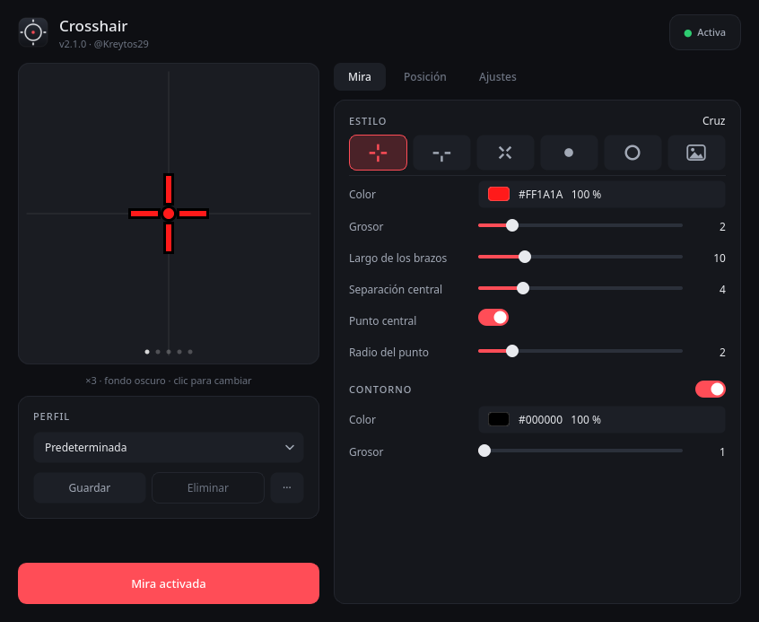

# Crosshair

Una mira para juegos en Linux. Se dibuja encima de todas las ventanas, deja
pasar los clics y se controla desde un icono en la bandeja del sistema.



- Seis estilos: cruz, cruz en T, aspa, punto, círculo e imagen propia (PNG o SVG).
- Contorno con color y grosor, para que la mira se vea sobre cualquier fondo.
- Perfiles guardados, que se pueden exportar a un archivo y compartir.
- Elección de monitor y desplazamiento del centro, con un mapa para arrastrarla.
- Atajos de teclado para activarla, desactivarla y cambiar de perfil.

## Requisitos

Un compositor Wayland con `wlr-layer-shell`: Hyprland, Sway, River, Niri o KDE
Plasma. GNOME no implementa ese protocolo, así que por ahora no está soportado.

En Arch Linux:

```sh
sudo pacman -S python python-pyqt6 python-gobject python-cairo gtk4 gtk4-layer-shell
sudo pacman -S qt6-svg   # opcional, solo para importar miras en SVG
```

En Debian o Ubuntu los paquetes son `python3-pyqt6`, `python3-gi`,
`python3-gi-cairo` y `libgtk-4-1`. `gtk4-layer-shell` todavía no está en los
repositorios y hay que compilarlo desde
[su página en GitHub](https://github.com/wmww/gtk4-layer-shell).

## Ejecutar sin instalar

```sh
python run.py
```

## Instalar

```sh
git clone https://github.com/Kreytos29/Toast-Crosshair-Linux-
cd Toast-Crosshair-Linux-
./install.sh
```

Copia el programa a `~/.local/share/crosshair` y deja el comando `crosshair`, el
icono y la entrada del menú de aplicaciones. No usa pip ni toca el Python del
sistema: las bibliotecas (PyQt6, PyGObject…) son las de tu distribución, y si falta
alguna el instalador te dice qué paquete instalar. Para actualizar, vuelve a correr
`./install.sh`; tus ajustes no se pierden.

## Desinstalar

```sh
./uninstall.sh          # conserva tus perfiles y ajustes
./uninstall.sh --todo   # borra también ~/.config/crosshair
```

Quita el comando, el icono, la entrada del menú, el inicio automático y el
programa, y cierra la mira si estaba activa. Funciona también desde
`~/.local/share/crosshair/uninstall.sh` si ya borraste la carpeta descargada.

## Uso

```
crosshair                  abre la ventana de ajustes
crosshair --hidden         inicia solo en la bandeja
crosshair --toggle         activa o desactiva la mira
crosshair --on, --off      la activa o la desactiva
crosshair --profile NOMBRE aplica un perfil por su nombre
crosshair --next-profile   pasa al perfil siguiente
crosshair --list-profiles  lista los perfiles
crosshair --status         muestra el estado
crosshair --quit           cierra el programa
```

Solo se ejecuta una instancia. Las demás le mandan la orden por un socket y
terminan, así que un atajo de teclado responde al instante.

### Hyprland

Hyprland 0.55 pasó su configuración de `hyprland.conf` a `hyprland.lua`. La
0.56 todavía acepta las dos, pero el analizador antiguo ya se quitó de la rama
de desarrollo. La pestaña **Ajustes** mira cuál tienes, te enseña las líneas que
te sirven con la ruta correcta y trae un botón para copiarlas; también puedes
ver el otro formato con el selector.

Con `hyprland.lua`:

```lua
-- Crosshair
hl.on("hyprland.start", function() hl.exec_cmd("crosshair --hidden") end)
hl.bind("SUPER + F10", hl.dsp.exec_cmd("crosshair --toggle"))
hl.bind("SUPER + SHIFT + F10", hl.dsp.exec_cmd("crosshair --next-profile"))
hl.window_rule({ name = "crosshair-float", match = { class = "^(crosshair)$" }, float = true })
```

Con `hyprland.conf`:

```
exec-once = crosshair --hidden
bind = SUPER, F10, exec, crosshair --toggle
bind = SUPER SHIFT, F10, exec, crosshair --next-profile
windowrule = match:class ^(crosshair)$, float on
```

La última línea usa la sintaxis de Hyprland 0.53 o posterior. En versiones
anteriores es `windowrulev2 = float, class:^(crosshair)$`.

En lugar de la línea de arranque puedes activar **Iniciar con la sesión** en la
pestaña Ajustes, que crea el acceso en `~/.config/autostart`. Usa una de las dos
cosas, no las dos.

## Archivos

Todo vive en `~/.config/crosshair/` (o en `$XDG_CONFIG_HOME/crosshair/`):

| Archivo | Qué guarda |
|---|---|
| `config.json` | la mira actual: estilo, colores, monitor y posición |
| `profiles.json` | los perfiles del usuario |
| `images/` | las imágenes importadas, siempre convertidas a PNG |

Los perfiles de versiones anteriores (`presets.json`) se migran solos la primera
vez; el archivo antiguo se conserva por si acaso.

## Cómo está hecho

Son dos procesos a propósito, porque GTK4 no tiene API de bandeja del sistema y
no conviene mezclar GTK con Qt en el mismo proceso:

```
crosshair/
├── geometry.py        la forma de la mira, sin depender del motor de dibujo
├── config.py          valores, validación y lectura y escritura de los archivos
├── ipc.py / cli.py    órdenes a la instancia en ejecución y línea de comandos
├── share.py           importar y exportar una mira como archivo
├── hyprland.py        las líneas de configuración para copiar, en sus dos formatos
├── overlay/           proceso del overlay: GTK4 + gtk4-layer-shell + Cairo
└── ui/                proceso de la interfaz: PyQt6, bandeja y ajustes
```

La ventana de ajustes nunca le habla al overlay: escribe `config.json` y el
overlay, que vigila la carpeta, se actualiza solo. Los dos piden las formas de
la mira a `geometry.py`, así que la vista previa y lo que se ve en pantalla no
pueden quedar distintas.

El overlay es una capa `OVERLAY` de `wlr-layer-shell` sin anclas, con la zona
exclusiva en `-1` para que el compositor la centre en el monitor completo y no
en el hueco que dejan las barras. Su región de entrada está vacía, así que
todos los clics pasan a la ventana de abajo.

## Pruebas

```sh
python -m unittest discover tests -v
```

Las pruebas de la interfaz necesitan PyQt6 y se saltan solas si no está. Para
ejecutarlas sin pantalla: `QT_QPA_PLATFORM=offscreen`.

## Licencia

MIT. Ver [LICENSE](LICENSE).
